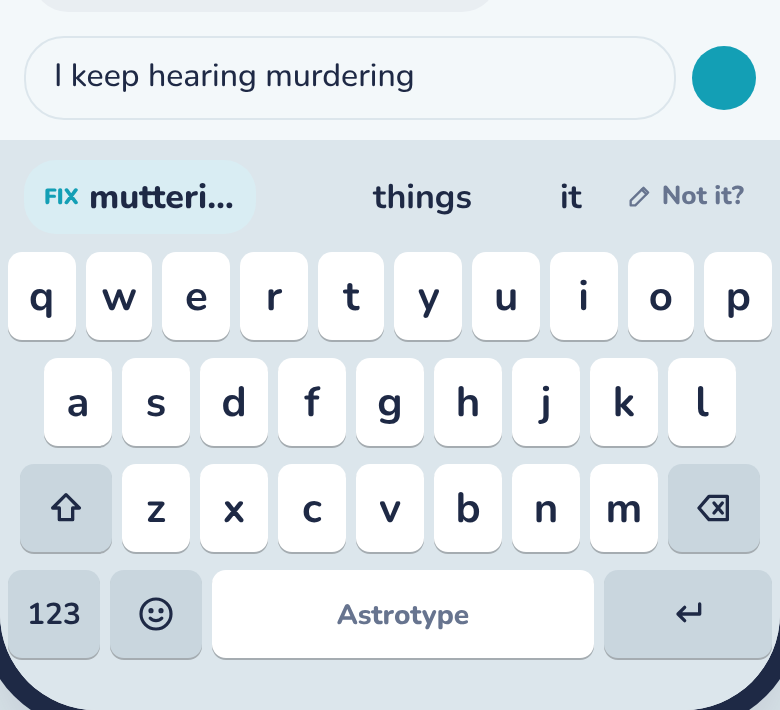
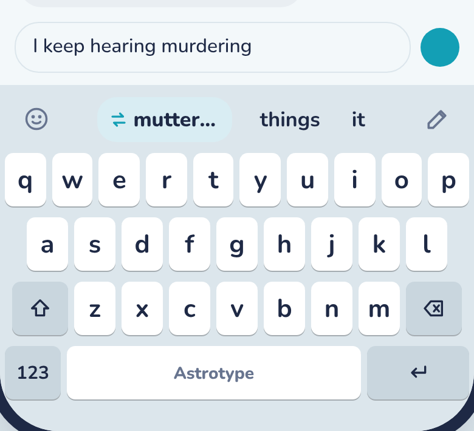
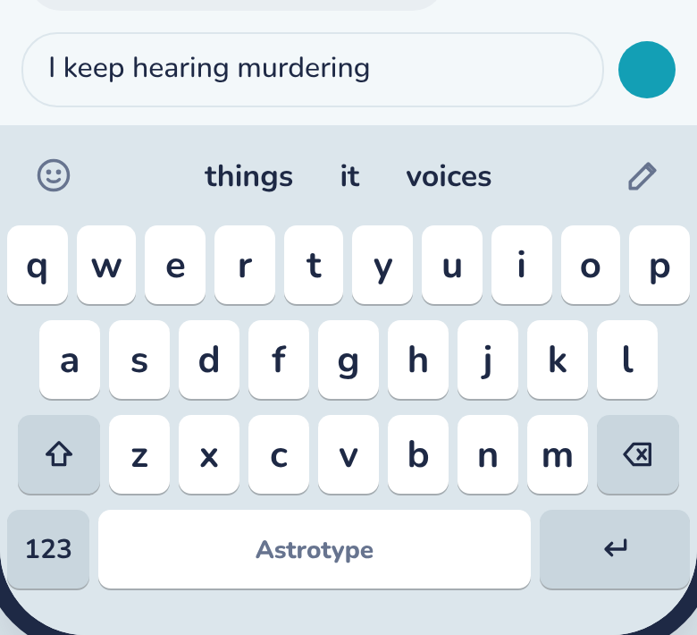
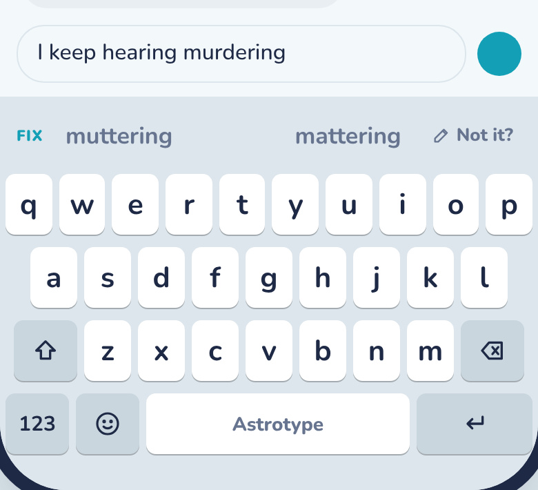
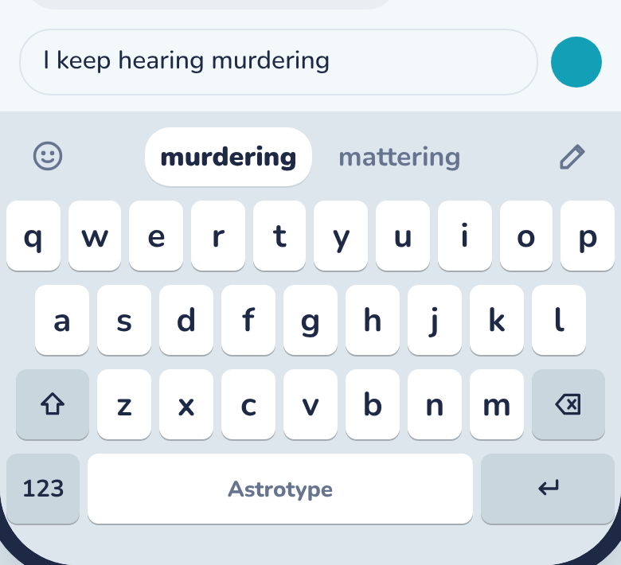
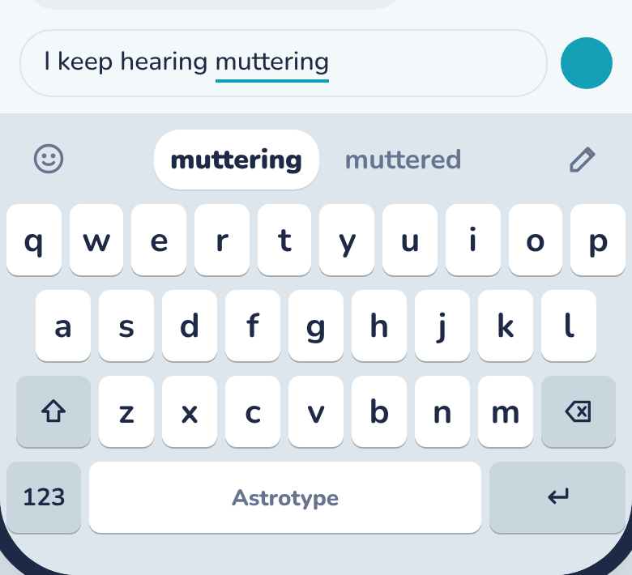
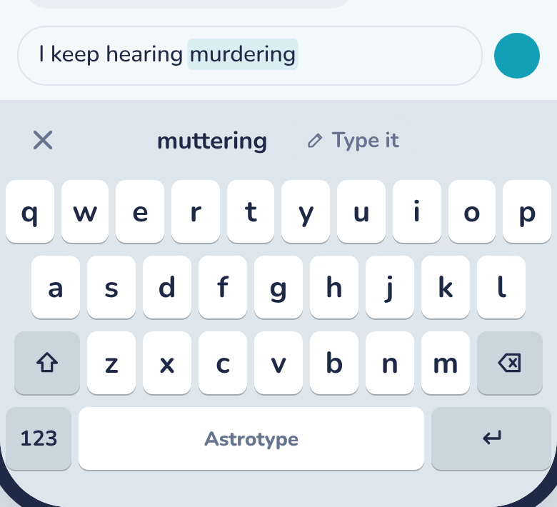
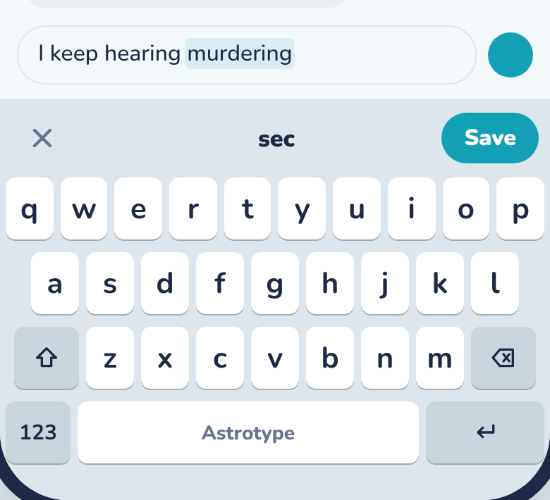
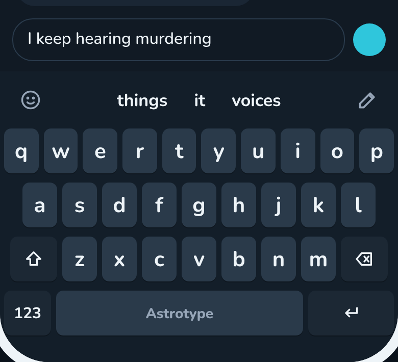

# Astrotype: the guesses bar, redesigned

The strip above the keys gets one place for each thing: the words in the middle, always
centred, and small buttons at the two ends, so it is obvious what each part does.

## Product

Status: Draft

- **The problem:** Gabriel (3 Nov 2026): "It's confusing what each thing is." Today the
  bar mixes three kinds of things in one row and spreads them to the edges: a FIX label
  or chip for the last word at the far left, guesses for the next word pushed apart,
  and "Not it?" at the right
  ([today, on a phone](design/screens/00-today-device.png)). A person can't tell which
  words change the word just written and which write a new one.
- **Who wants it:** everyone. The bar is on screen for every word.
- **Basics or powerful:** basics. No new setting.
- **How it works:** the bar has three zones that never move:
  - *Left end:* one button. The emoji key (from the wider space bar plan,
    `features/space-bar`, PR #105), or ✕ while fixing a word.
  - *Middle:* the words, packed together and centred on the keyboard, never spread to
    the edges. Only one kind at a time: guesses for the word you're swiping, or likely
    next words. When a word is being guessed, the one space writes sits in the white
    pill in the centre, the other guesses either side of it.
  - *Right end:* the pencil ("Not it?") after a swiped word, and on Home-button
    iPhones the globe after it.
- **Fixing the last word** is the choice for Gabriel:
  - **Option A, a swap chip:** after a word, the best other reading sits first in the
    middle as a chip with a ⇄ swap mark (replacing the "FIX" text), a hairline, then
    two next words. The pencil opens "What did you mean?" as today. One tap to fix, but
    the middle still holds two kinds of thing.
  - **Option B, fixes behind the pencil (recommended):** after a word the middle shows
    only next words (three, not two). Tapping the pencil turns the bar into the fix
    row: ✕ on the left, the other readings in the middle, and "Type it" last, which
    opens the "What did you mean?" field. The word being fixed is highlighted in the
    text so it is clear what changes. Fixing takes one more tap, but the bar never
    asks the person to tell two kinds of word apart, and next words get their third
    slot back.
  - Either way, with "Guess the next word" off, the bar after a word shows the word
    just written in the pill with its other readings either side, the same shape as
    while swiping, so the FIX label goes away entirely.
- **What it changes:** the bar's layout in every state (DESIGN.md "The bar"), the FIX
  label and chip (features/next-word), where "Not it?" sits (features/missed-words).
  Under option B the one-tap FIX chip from next-word option A goes away.
- **Scope:** now: the phone bar. The column beside a split or wide keyboard keeps its
  stacked layout but follows the same rules (one kind of word at a time, the pencil
  under them). Later: nothing planned.
- **What we measure:** no new metrics. `nextword.picked` and `miss.saved` already show
  whether people use next words and the pencil; we watch them before and after. Under
  option B, add a count of fixes picked from the fix row (`bar.fix_picked`) so we can
  see if the extra tap costs us fixes.
- **Open question** for Gabriel: option A or B (the mockup shows both; B recommended).

## Design

Status: Draft

- **Mockups:** `design/mockups/guesses-bar.html` (Artifact link:
  https://claude.ai/artifact/7fGTgXpYQFUrw4qv4o3Cxn). Pick a design (Today, A, B) and a
  moment, then tap the words, the chip and the pencil; the keys type into the "What did
  you mean?" field. "Show zones" labels the three parts.
- **What changes:**

  | Moment | Today | A | B |
  |---|---|---|---|
  | Right after a word |  |  |  |
  | After a word, next words off |  | same as B |  |

  - *Swiping a word* (A and B): 
  - *Pencil tapped* (B only, the fix row): 
  - *"What did you mean?"* (A and B, as today, now with ✕ in the left slot): 
- **Layout rules:**
  - The two end slots are each 44 pt wide (one icon button, 44 pt touch target). When
    one end holds two buttons (pencil and globe), both ends widen to 88 pt so the middle
    stays centred on the keyboard. An empty end stays empty; nothing slides into it.
  - Words in the middle hug their text with 6 pt between them, at most three. The
    chosen guess is in the centre. When three don't fit whole, the outer guesses drop
    one at a time (never the chosen one) rather than truncating, so a long word is
    never cut ([long words, small phone, with globe](design/screens/09-B-long-small-globe.png)).
  - The idle note ("Both thumbs, one word") and the "Two thumbs is in Astrotype Pro"
    notice centre in the middle zone, with the ends as they are.
- **Motion and copy:** new next words rise in over 0.25 s as today. Picking from the
  fix row squeezes the bar like a commit and returns to next words. "Not it?" stays as
  the pencil's VoiceOver label (no visible text); the fix row's last choice reads
  "Type it". No other new copy.
- **Design system:** the existing guess button (plain and pill), the ice chip and the
  hairline. New: a bar icon button (44 pt, `muted` SF Symbol, `keyDark` when pressed)
  used for emoji, pencil, globe and ✕, and the dashed "Type it" chip (`line` border).
  Option A's chip swaps the "FIX" text for the `arrow.left.arrow.right` symbol in
  `accent`. No new tokens.
- **Sizes:** the bar is the same height everywhere. On the small phone the middle drops
  guesses rather than cut words. Wide screens and the split keyboard put the guesses in
  a column, where the emoji and globe go back to the bottom row (PR #105).
- **Dark:** 
- **Accessibility:** VoiceOver reads the bar as "Suggestions": left button, the words
  in order, right buttons. Pencil: "Not it? Fix the last word". The fix row's words get
  the hint "Replaces the last word". Dynamic Type scales the words one step as today.

## Build

Status: Not started

- **Approach:** `BarView` only, plus a small model change for option B. The bar becomes
  three views (left slot, middle stack, right slot) laid out by `BarView`; the middle
  stack is centred on the bar's width and drops outer guesses to fit. The space bar
  thread's emoji and globe buttons go into the slots (coordinated with PR #105).
- **Core pieces:** option B adds `Composer.Bar.fixing([String], chosen: Int)` (the fix
  row), entered by `Composer.beginFix()` from the pencil and left by a pick, ✕ or any
  key; `Bar.next` then no longer needs its `fix` payload shown, but keeps it so the fix
  row knows the readings. Tested in `ComposerTests` and `MissedWordTests`.
- **Phases:** one PR: the three-zone layout and the chosen option, with DESIGN.md "The
  bar" updated. Done when: on a phone the words sit centred in every state, the pencil
  works, and nothing is cut off on the small size or the largest text size.
- **Risks:** emoji and globe in the bar depend on PR #105 landing; until then the left
  slot is empty and the globe stays in the bottom row.
- **Last step:** fold this into `DESIGN.md` "The bar" and screen 12.
