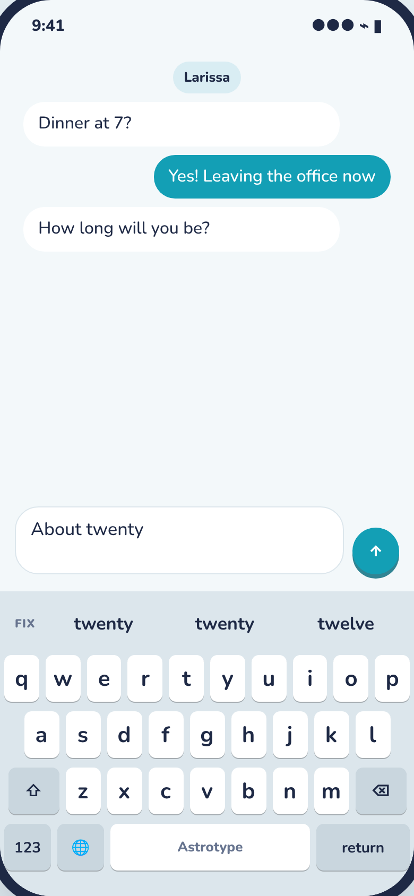
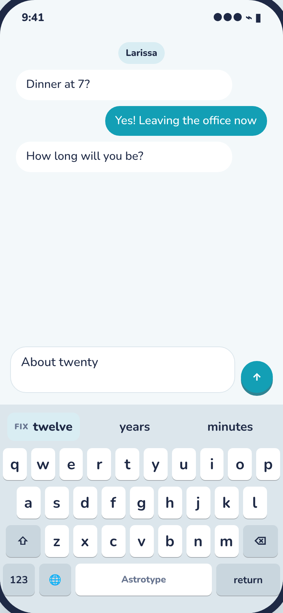
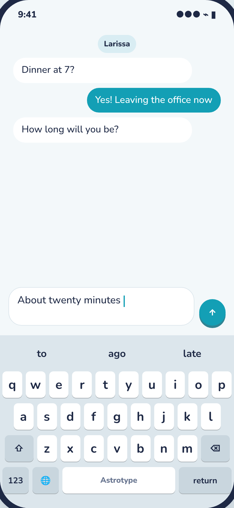
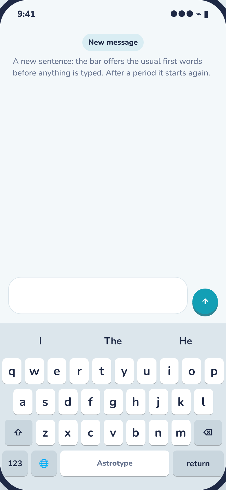
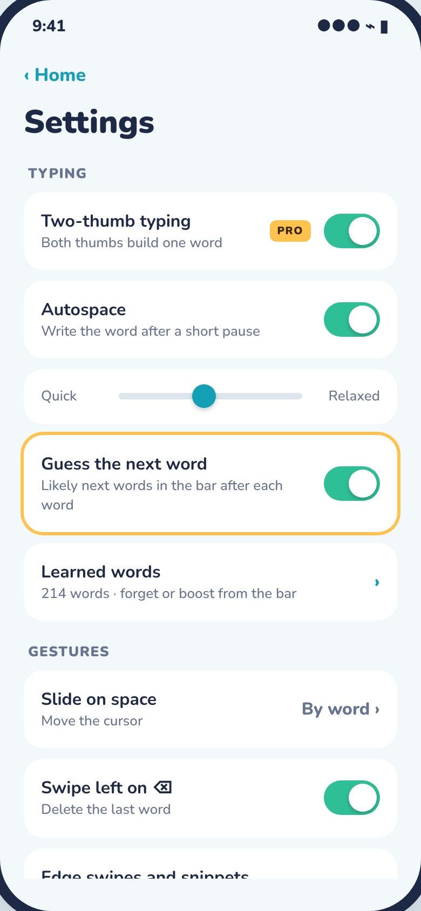
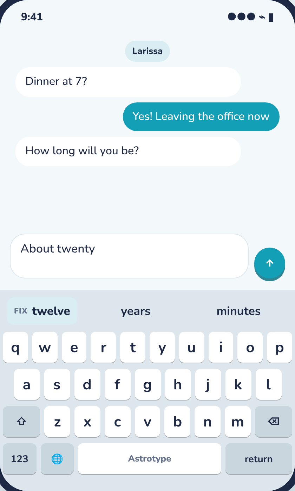
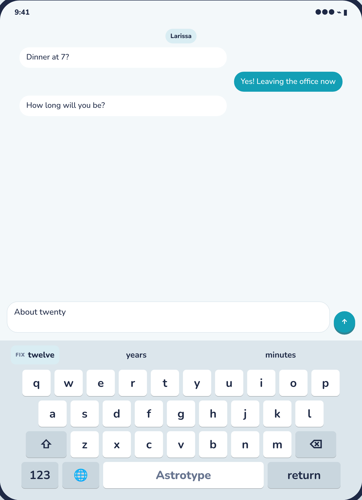
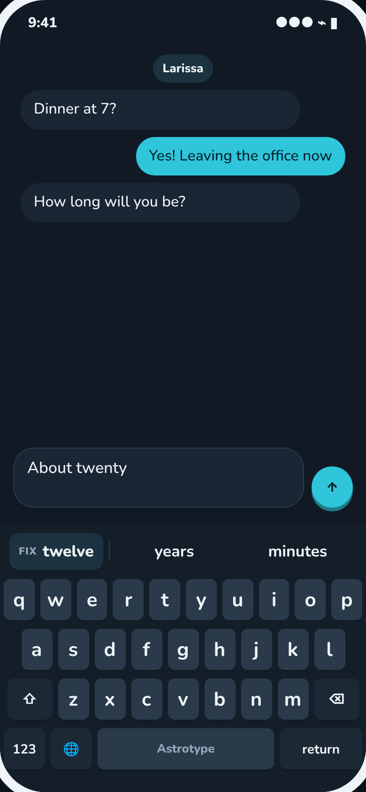

# Astrotype: guess the next word

After each word, the bar offers the words most likely to come next, so a tap writes
"to" or "the" instead of a swipe.

## Product

Status: Draft

- **The problem:** every word costs a swipe or a few taps, even the ones anyone could
  guess: "to" after "going", "you" after "thank", "the" after "on". Apple's keyboard
  and every other phone keyboard offer these; ours shows nothing until you touch a key.
  PRODUCT.md lists "next-word suggestions while nothing is being typed" under Later,
  and the word-pair model they need already ships (features/smart-matching, Phase A).
- **Who wants it:** everyone, most of all people still learning two-thumb typing, for
  whom a short common word is still slow. Fast typers can ignore it: it never writes
  anything on its own.
- **How much it saves:** on the English pairs we ship, the next word is one of the top
  three guesses about one time in three (two guesses: 28%, one: 20%). That figure is
  from the model's own counts on Tatoeba sentences, not from real typing; Gabriel's
  own messages will differ, and the personal pairs (below) push it up over time.
- **Basics or powerful:** basics. On by default, nothing to learn, free for everyone.
  One switch in Settings turns it off.
- **How it works:**
  1. A word goes in (space, autospace, punctuation or a guess from the bar).
  2. The bar shows the likely next words, best first, cased for where they go ("I",
     "The" at a sentence start; "i" always as "I").
  3. Tap one and it is written with a space after it, as if it had been typed. The bar
     then guesses the word after that, so common phrases are a few taps ("thank" →
     "you" → "so" → "much").
  4. Touch the keys instead and the guesses go away; nothing changes in the field.
  - At the start of a message or after a period, the bar offers common first words.
    After a comma, a number or a word the model does not know, it offers nothing and
    shows the idle note, as today.
- **Where the guesses come from:** the shipped English word pairs (`bigrams.bin`),
  mixed with the person's own pairs from "Learns from you" (smart-matching Phase B),
  so "flotilla" → "ships" shows up for the person who writes it. Contractions are left
  out until the keyboard can type apostrophes ("dont" is not offered). Everything is
  worked out on the phone; nothing typed goes anywhere.
- **Where it stays quiet:** the same fields where the keyboard does not learn
  (passwords, email, URL, number and one-time-code fields, or where the app turned
  autocorrection off), and while "Guess the next word" is off.
- **What it changes:** the bar's Fix state (DESIGN.md "The bar"). Today, right after a
  word goes in, the bar shows FIX and the other readings of that word until the next
  touch. Both need the same strip. How they share it is the one open question below.
- **Scope:**
  - In this version: next words after a word or at a sentence start, tap to write,
    the personal pairs mixed in, the setting, English.
  - Later: finishing the open word ("prob" → "probably"), which the guesses for the
    open word mostly do already; three-word context; apostrophes.
  - Never: writing a guess without a tap, or sending anything typed to work it out.
- **What we measure:** the keyboard sends no metrics (CLAUDE.md), so:
  - `nextword.picked` (count, sent by the app): the keyboard counts words written from
    a next-word guess in the App Group file it already writes for the app (a number,
    never a word; Full Access only), and the app sends the count with the keyboard's
    health readings. Its share of words written says whether people use it.
  - Offline, the harness reports how often the word typed was among the guesses
    (`astrotype-tools replay` and `synth`), on synthetic sessions now and real shared
    sessions later.
- **Open questions** for Gabriel:
  1. After a word goes in, what does the bar show? (asked in the thread)
     - **A. Fix chip, then next words** (recommended): one row. The best other reading
       of the last word sits on the left in a small tinted chip marked FIX, then two
       next-word guesses. With nothing to fix, three guesses.
     - **B. FIX first, next words after a beat:** FIX as today, then after about a
       second (at once when there is nothing to fix) the bar turns into next words.
     - **C. Next words only:** like Apple's keyboard. To fix a word, backspace into it
       and pick from its guesses (that already works today).
     A keeps one-tap fixes, which swipes need more than taps do, and the bar never
     changes under a thumb that is about to tap. It costs one guess slot when there
     is something to fix (28% instead of 34% of words a tap away). B gets all three
     slots but changes on a timer, so a tap aimed at a fix can land on a next word.
     C is the simplest and the most familiar, but a wrong swipe costs a backspace and
     a tap instead of one tap.

## Design

Status: Draft

- **Mockups:** `design/mockups/next-word.html`, built from the app's mockup with the
  real English pairs in it (Artifact link: https://claude.ai/artifact/8Geooiwsg8MLENpd4rzFhq). "Bar after a word" switches
  between options A, B and C. Type a word, then tap a next word.
- **What changes:**
  - *The bar after a word* (screen 12, Typing in Messages): before, FIX and the other
    readings; after (option A), the fix chip and two next words.

    | Before | After | After tapping "minutes" |
    |---|---|---|
    |  |  |  |

  - *The bar's idle state* at the start of a message shows first words instead of the
    note: 
  - *Settings → Typing* gains "Guess the next word" (toggle, on): "Likely next words in
    the bar after each word". It also goes on the keyboard's own settings panel (under a
    held 123), next to the other typing switches, so it works without Full Access. With
    the settings redesign (PR #72) it sits on the Typing page.
    
- **New screens:** none.
- **Bar states** (DESIGN.md "The bar" gets a fourth): *Next:* up to three next-word
  guesses in the plain guess style (no white pill, because space does not write them);
  with option A, the fix chip first. The column layout (split and wide keyboards) stacks
  them the same way: the fix chip on top, then the next words.
- **Motion and copy:** the guesses fade up over 0.25 s when they change (instant with
  Reduce Motion); a tap gives the key haptic and the same small squeeze the bar gives on
  autospace. The fix chip reads "FIX" in the existing small caps label, then the word.
  No new copy beyond the setting.
- **Design system:** the bar's existing guess buttons and FIX label. One new piece in
  `BarView`: the fix chip, a guess button on the `ice` fill with the FIX label inside,
  and a hairline (`line`) between it and the next words. No new tokens.
- **Sizes:** the bar is the same height everywhere. On the smallest phone (Duo outer)
  the chip is capped at 38% of the bar so long words truncate in the chip, not in the
  guesses. On the wide Duo inner screen the three slots just get wider.

  | Small | Wide | Dark |
  |---|---|---|
  |  |  |  |

- **Accessibility:** VoiceOver reads the bar as "Suggestions" as today; next words read
  as "Next word: minutes", the chip as "Fix: twelve". Dynamic Type scales the bar text
  one step as the other bar states do.
- **Open questions** for Gabriel: the bar option above.

## Build

Status: Not started

- **Approach:** all ranking in `AstrotypeCore`, pure and tested; the composer owns the
  bar, so it gains the new state and the tap; `BarView` draws it.
- **Core pieces:**
  - `NextWords` (new, `Engine/`): `NextWords(language:).guesses(after context: [String],
    personal: PersonalIndex, count: Int) -> [String]`. Scores each candidate as the
    shipped pair probability mixed with the person's pair counts (the same caps the
    matcher uses), drops contractions and words the person forgot. `NgramModel` gets a
    `topNext(after:limit:)` that picks the best few without sorting the whole run (one
    pass over the previous word's pairs, which are at most a few thousand), so it fits
    in well under a millisecond.
  - `Composer`: `Bar.next([String], fix: String?)` (option A; the shape follows the
    answer), `choose(next:)` writes the word plus an auto space (the same path as a guess
    from the bar, so "one space between words" and learning both hold), and
    `Settings.nextWords` (on/off). The guesses are worked out once per commit, not per
    touch, so typing speed is untouched.
  - `KeyboardSettings.nextWords`, defaulting on, synced like the rest.
  - `KeyboardModel`: turns the setting and "guesses here" (the existing learns-here
    check) into the composer's setting; counts picks for `nextword.picked`.
- **Phases:**
  1. *Next words in the bar:* `NextWords`, the composer state and tap, `BarView`'s next
     state and fix chip, the setting in Settings and the panel. Done when: in Messages,
     "going" offers "to", tapping it writes "to " and offers "the"; a new message offers
     "I"; a password field offers nothing; the chosen fix option works on the small,
     large-text and wide sizes.
  2. *Measured:* the harness reports how often the word typed was a next-word guess,
     recorded here; the pick count goes out through the app as `nextword.picked`.
- **Risks:** the Tatoeba pairs lean on story text ("He", "She" at sentence starts, "the
  same" after "the"), so the first guesses may feel bookish until the personal pairs
  catch up. If they do, the fix is a better corpus for the pairs, not code.
  `MatcherTests.candidatesAreFast` does not cover this (no matcher change), but the
  commit path gets a timing test of its own.
- **Metrics:** `nextword.picked` with `Telemetry`, from the app.
- **Last step:** fold this feature into the app's `PRODUCT.md` (out of Later) and
  `DESIGN.md` (the bar's states, screen 12, the setting).
