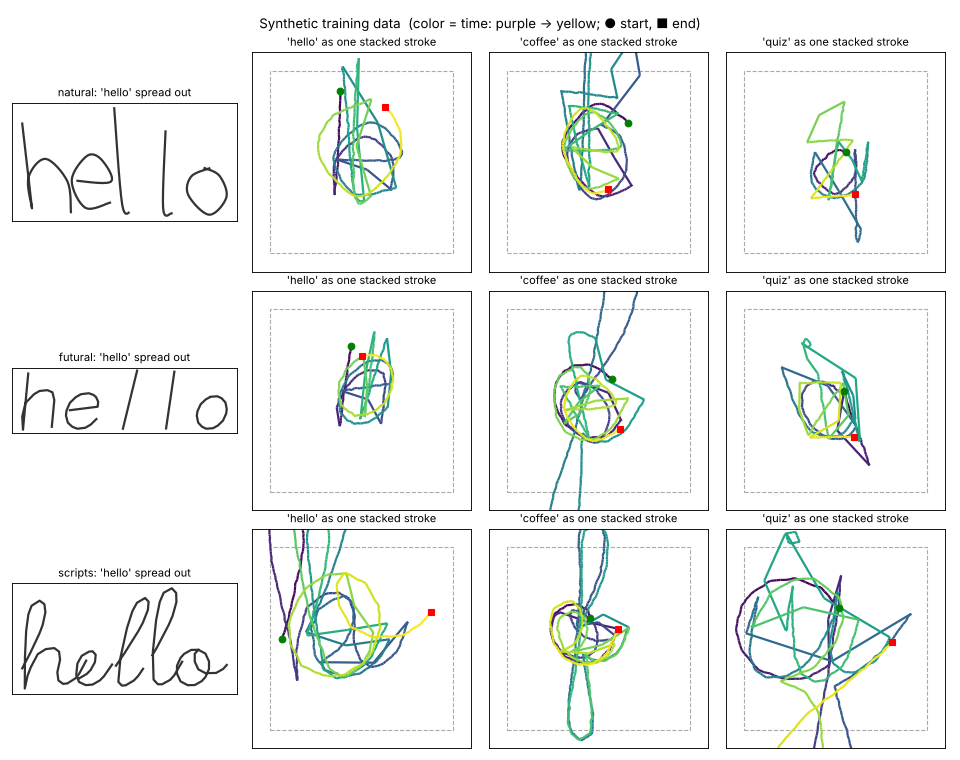

# StackWrite

An iOS keyboard for typing without looking. You write a whole word as one finger stroke,
with each letter stacked on top of the last one in the same spot. An on-device model and a
dictionary turn that stroke into a word.

## Status

- **Model prototype: done** (`ml/`). Trained on synthetic data only. It's 99.9% accurate on
  the letter styles it has seen, but needs about 50+ of your own sample words to read a new
  style well.
- **iOS app: in-app keyboard and training.** "Try the keyboard" types into a text field
  with the StackWrite pad, all on device. "Write training words" records labeled samples
  (format in `SAMPLES.md`) and exports them as a zip. No keyboard extension yet. See
  `BRIEF.md` for the build plan.
- **Training on real writing:** `ml/finetune.py` takes exported samples, fine-tunes the
  model (Apple GPU on a Mac), scores it on held-back words and can copy it into the app.

## Layout

```
BRIEF.md   build plan, plus the exact contracts the Swift code must match
SAMPLES.md the recorded-sample format shared by the app and the training scripts
CLAUDE.md  how to work on this app
ml/        Python prototype: data synthesis, training, decoder, Core ML export
ios/       Xcode project: the app (keyboard extension comes later)
```


